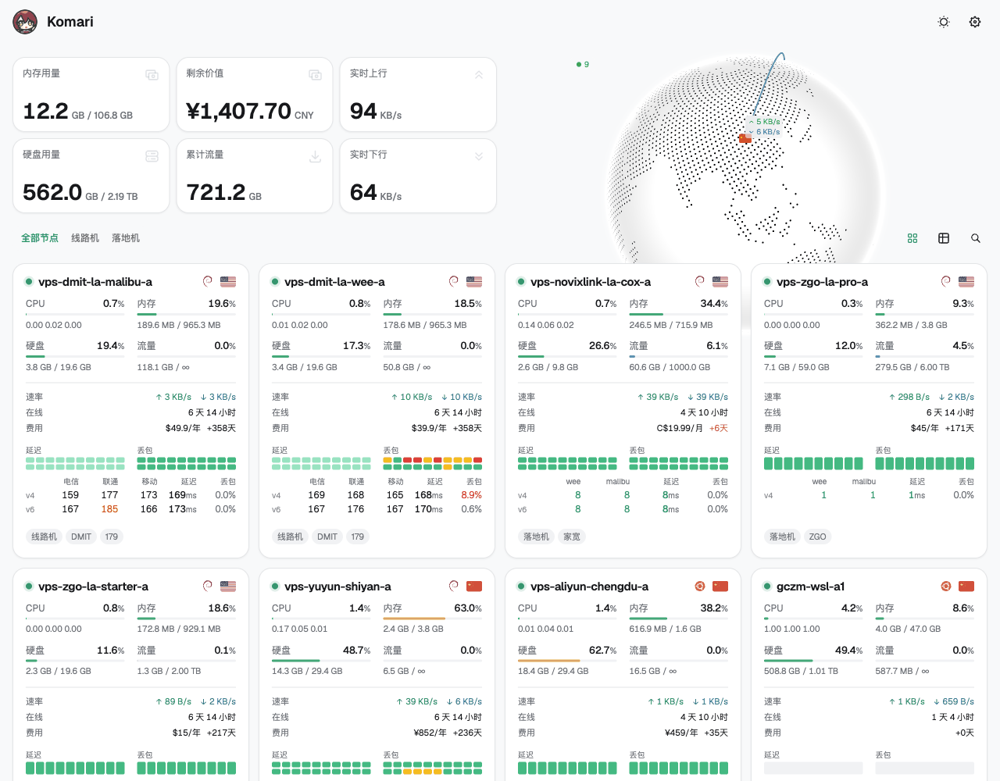

<h3 align="center"> Komari Tundra </h3>
<p align="center">
简洁现代的 Komari Monitor 主题，基于 Vue 3 + Vite + reka-ui + Tailwind CSS v4
</p>



## 特性

- 节点卡片：指标、费用、延迟分区排列，跨卡片对齐
- IPv4 / IPv6 双栈延迟：同一张表里各占一行，丢包与延迟分开看；详情图里 v6 用深色虚线
- GPU 使用率与温度图表（需 agent 上报 GPU 数据）
- 列表视图的「网络」列与卡片共用同一套数据
- 中性冷灰底色、白色卡片、翡翠绿点缀，字体为 Geist，数字等宽

延迟任务名以 ` v4` / ` v6` 结尾时会自动按双栈合并，例如 `四川电信 v4`、`四川电信 v6`。

## 使用

1. 从 [Release 页面](https://github.com/hoobnn/komari-theme-tundra/releases) 下载最新的 `komari-theme-tundra-build-*.zip`
2. 登录 Komari Monitor，进入 `设置` → `主题管理`
3. 点击 `上传主题`，选择下载的 zip
4. 启用 Tundra 后刷新页面

每个版本的变化见 [CHANGELOG.md](./CHANGELOG.md)。升级后页脚会显示当前主题版本号。

## 环境要求

- Node.js: `^20.19.0` 或 `>=22.12.0`
- Bun: `>=1.2.0`

## 开发

```bash
# 安装依赖
bun install

# 启动开发服务器
bun run dev

# 代码检查
bun run lint
```

## 构建

```bash
# 类型检查 + 生产构建
bun run build

# 预览生产构建
bun run preview
```

## 技术栈

| 类别     | 技术                             |
| -------- | -------------------------------- |
| 框架     | Vue 3                            |
| 构建工具 | Vite 8                           |
| UI 组件  | reka-ui（shadcn-vue 风格组件）   |
| 样式方案 | Tailwind CSS v4 + tw-animate-css |
| 状态管理 | Pinia 4                          |
| 路由     | Vue Router 5                     |
| 提示系统 | vue-sonner（Toaster）            |
| 图标     | @iconify/vue                     |
| 图表     | vue-echarts                      |
| 3D 地球  | cobe                             |
| 实用工具 | @vueuse/core, dayjs              |
| 代码规范 | ESLint (@antfu/eslint-config)    |

## 鸣谢

- [Komari](https://github.com/komari-monitor/komari)
- [Komari Emerald](https://github.com/Tokinx/komari-theme-emerald)
- [Komari Next](https://github.com/tonyliuzj/komari-next)
- [Komari Naive](https://github.com/lyimoexiao/komari-theme-naive)
- [Vue 3](https://vuejs.org/)
- [Vite](https://vitejs.dev/)
- [reka-ui](https://reka-ui.com/)
- [Tailwind CSS](https://tailwindcss.com/)

Tundra 派生自 [Komari Emerald](https://github.com/Tokinx/komari-theme-emerald)，Emerald 的基座基于 [Komari Naive](https://github.com/lyimoexiao/komari-theme-naive)，特此感谢

## License

[MIT](./LICENSE)
