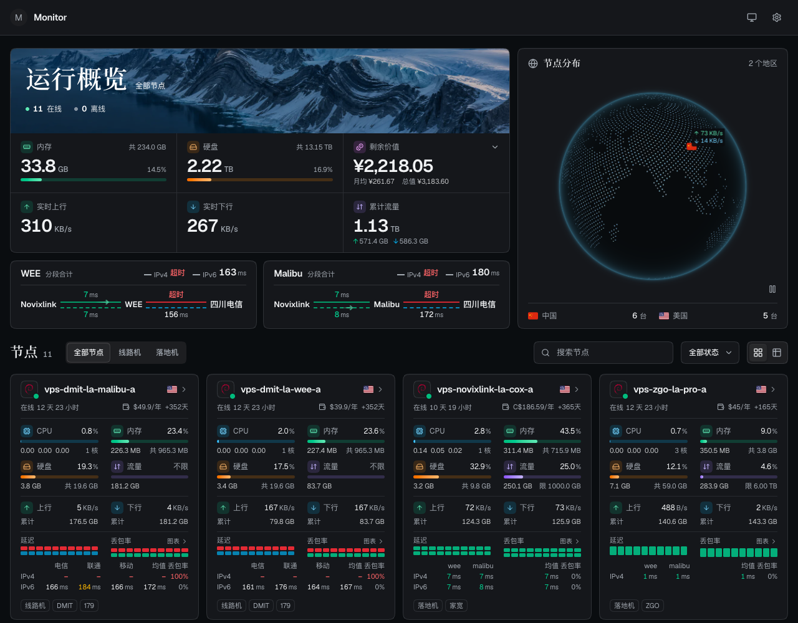

<h3 align="center"> Komari Tundra </h3>
<p align="center">
以极地观测图册为视觉主题的 Komari Monitor 面板，基于 React 19 + Vite + Radix UI + Tailwind CSS v4
</p>



[手机端浅色预览](./docs/preview-mobile.png) · [延迟与丢包图表](./docs/ping-history-preview.png)

## 特性

- 节点卡片：指标、费用、延迟分区排列，跨卡片对齐
- 双栈延迟曲线与丢包时间线按时间对齐，可逐点查看原始采样、时段均值和丢包率
- 负载图可固定在同一采样时刻，联动查看 CPU、内存、网络和 GPU 温度（需 Agent 上报 GPU 数据）
- 卡片和列表支持按分组、在线状态和关键词筛选，手机列表支持比较 CPU、内存和打开延迟图
- 可配置的首页中继线路卡片，显示各段延迟、双栈合计和沿途流光（[配置说明](./docs/relay-routes.md)）
- 冰湾版头配合宋体章节标题，界面与读数使用 Geist，支持浅色、深色和跟随系统

延迟任务名以 ` v4` / ` v6` 结尾时会自动按双栈合并，例如 `四川电信 v4`、`四川电信 v6`。

## 使用

1. 从 [Release 页面](https://github.com/hoobnn/komari-theme-tundra/releases) 下载最新的 `komari-theme-tundra-build-*.zip`
2. 登录 Komari Monitor，进入 `设置` → `主题管理`
3. 点击 `上传主题`，选择下载的 zip
4. 启用 Tundra 后刷新页面

每个版本的变化见 [CHANGELOG.md](./CHANGELOG.md)。升级后页脚会显示当前主题版本号。

## 环境要求

- Node.js: `^20.19.0` 或 `>=22.12.0`
- Bun: `>=1.2.0`

## 开发

```bash
# 安装依赖
bun install

# 启动开发服务器
bun run dev

# 代码检查与格式化（oxlint + oxfmt）
bun run lint
```

## 构建

```bash
# 类型检查 + 生产构建
bun run build

# 预览生产构建
bun run preview
```

## 技术栈

| 类别     | 技术                             |
| -------- | -------------------------------- |
| 框架     | React 19（React Compiler）       |
| 语言     | TypeScript 7                     |
| 构建工具 | Vite 8                           |
| UI 组件  | Radix UI（shadcn/ui 风格组件）   |
| 样式方案 | Tailwind CSS v4 + tw-animate-css |
| 状态管理 | Zustand 5                        |
| 路由     | React Router                     |
| 提示系统 | sonner                           |
| 图标     | @iconify/react                   |
| 图表     | ECharts 6                        |
| 3D 地球  | cobe                             |
| 实用工具 | dayjs                            |
| 代码规范 | oxlint（含类型感知规则）+ oxfmt  |

## 鸣谢

- [Komari](https://github.com/komari-monitor/komari)
- [Komari Emerald](https://github.com/Tokinx/komari-theme-emerald)
- [Komari Next](https://github.com/tonyliuzj/komari-next)
- [Komari Naive](https://github.com/lyimoexiao/komari-theme-naive)
- [React](https://react.dev/)
- [Vite](https://vitejs.dev/)
- [Radix UI](https://www.radix-ui.com/)
- [Tailwind CSS](https://tailwindcss.com/)

Tundra 派生自 [Komari Emerald](https://github.com/Tokinx/komari-theme-emerald)，Emerald 的基座基于 [Komari Naive](https://github.com/lyimoexiao/komari-theme-naive)，特此感谢

## License

[MIT](./LICENSE)
