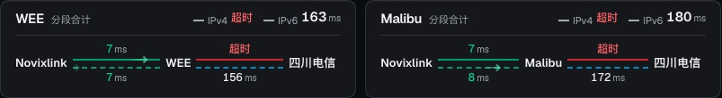

# 首页线路延迟

下面是使用线上公开采样快照的本地预览；数值仅代表截图时刻。



在 Komari 的 Tundra 主题设置中开启「显示线路延迟」，再在「线路配置 JSON」中填写线路数组。默认关闭；留空时开启会显示配置提示，不会自动推断线路。

```json
[
  {
    "name": "电信 · WEE · 落地",
    "nodes": ["四川电信", "DMIT WEE", "落地机"],
    "legs": [
      { "client": "线路机的节点 UUID", "taskId": 1 },
      { "client": "落地机的节点 UUID", "taskId": 7 }
    ]
  }
]
```

示例仅说明配置结构，不代表站点实际使用的转发关系；任务 ID 和节点 UUID 都需替换为你自己的值。`client` 始终是**发起该次 Ping 的 Agent UUID**，`taskId` 是它参与的探测任务 ID。任务必须对当前访客可见，并且真的有此节点的记录。首页节点详情 URL 包含 UUID，公开任务列表可通过 `/api/task/ping` 查询。

- `name`：线路的唯一名称，最多 120 字符。
- `nodes`：展示顺序中的节点名称，2–9 项。`legs` 必须比它少一项；最多配置 12 条线路。
- `legs[i]`：对应 `nodes[i]` 与 `nodes[i+1]` 之间的探测，不从名称推测目标。
- `staleAfterSeconds`：每段可选，默认 180 秒，允许 30–86400 秒。应至少为实际探测间隔的 2–3 倍。

两端独立 Ping 是往返测量，方向反过来也不能证明实际业务路由。若用线路机到国内目标的 Ping 表示国内这一段，应自行确认测量方向与实际链路含义。此组件始终称为「分段合计」，不将它作为经过所有中转节点的端到端延迟；需要后者时应另建穿过中转通道的实际探测任务。

## 数据与交互

复用节点卡片的共享 `common:getRecords` 查询（`hours: 1`），每分钟刷新一次，不新增后端接口、连接或依赖。每段显示最新采样延迟；负数记录视为失败，0 ms 是有效值。

每段显示最新一次探测。超时用红线和「超时」标出，缺测用「无数据」，超出该段有效期显示「已过期」。所有段都有有效延迟时，卡头才显示对应协议的分段合计。刷新失败时保留已有记录，继续按采样时间判断过期。

线路名带有相同前缀和协议后缀（例如 `WEE IPv4`、`WEE IPv6`）且站点相同，会合并为一张卡。卡片区域宽度达到 36rem 时两列并排，窄屏单列。站点名称之间的实线对应 IPv4，虚线对应 IPv6。段延迟分别放在线的上方和下方。多站线路按可用宽度折行，上一行的末站也是下一行的起点。

点击两站间的线段，或用 Tab 移到线段再按 Enter，可查看各协议最新延迟、近十分钟丢包率及采样时间。按 Esc 会关闭详情并回到原线段。

相邻的连通段共用一道低亮度流光，在站名下方穿过。流光在超时或缺测处中断，鼠标悬停或键盘聚焦时停在当前位置。系统或主题启用减弱动画时，静止箭头标出下一站方向。

### 延迟与丢包配色

节点卡、列表、线路分段和合计共用以下延迟阈值。趋势条按各自时段的数据着色。

| 读数           | 数值                 | 延迟趋势条或分段线 |
| -------------- | -------------------- | ------------------ |
| 0–80 ms        | 绿色                 | 绿色               |
| >80 至 180 ms  | 正文色               | 天蓝色             |
| >180 至 240 ms | 琥珀色               | 琥珀色             |
| >240 ms        | 红色数字             | 红色               |
| 超时           | 卡内显示红色「超时」 | 红色               |
| 缺测或数据过期 | 卡内显示灰色状态文字 | 灰色               |

丢包率 ≤1% 时数字用中性色、趋势条用绿色，>1% 至 6% 用琥珀色，>6% 用红色。延迟详情图用曲线颜色区分线路，IPv4 用实线、IPv6 用虚线，丢包时间线按协议独立成行，绿色表示实测无丢包，琥珀色表示部分丢包，红色表示全丢，灰色表示无采样。

## 代码入口

- `src/utils/relayRoutes.ts` 负责配置校验与分段采样状态。
- `src/utils/pingDisplay.ts` 负责延迟和丢包率的显示规则与颜色阈值。
- `src/components/home/RelayRoutes.tsx`：线路卡布局与流光。
- `src/hooks/useNodePingStats.ts`：共用的 Ping 数据订阅。
- `src/views/HomeView.tsx`：首页位置，概览之后、节点工具栏之前。

新设置在主题包导入后才会出现在后台；保存后刷新前台生效。无需将本次源码改动直接上传到生产站点。
